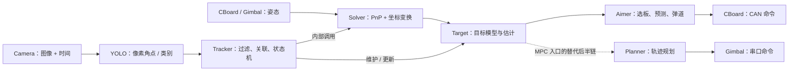

# sp_vision_25 重构导读

面向：共同维护一个 C++ 主仓的三名队员。目标是理解同济工程怎样把图像变成云台命令，为我们拆分输入、算法和输出提供参考。

## 1. 整体架构：先知道每层负责什么

这是 C++17/CMake 工程，普通自瞄通过进程内对象调用组织，不要求 ROS2。**入口文件负责组装整条链；目录不是独立进程。**

| 位置 | 主要职责 | 阅读时抓什么 |
|---|---|---|
| `src/` | 各兵种、传统/MPC、多线程等运行入口 | 创建了谁、调用顺序、循环和线程归谁管 |
| `io/` | 相机、姿态接收、CAN/串口、部分 ROS2 接口 | 图像、时间和状态怎样进入；命令怎样出去 |
| `tasks/auto_aim/` | 检测、解算、跟踪、瞄准与规划 | 算法输入输出，以及哪些功能互相依赖 |
| `tools/` | 数学、弹道、EKF、日志、录像、队列等 | 沿调用点按需查，不逐个通读 |
| `configs/`、`calibration/` | 参数与标定工具 | 模型、内外参、延迟和控制参数由谁读取 |
| `tests/`、`assets/` | 调试/回放程序，模型和样例素材 | 找最小运行入口；源码副本不一定带完整素材 |

先用传统入口建立下面这张图的认识：

**图是模块关系概览，具体调度由入口决定。**`Tracker::track()` 内部调用 `Solver` 并维护 `Target`，不是 main 先对全部候选统一执行一次 PnP。[Tracker 源码][tracker]

两条链要分清：[传统入口][standard]采用 `Aimer → CBoard`；[MPC 入口][mpc]采用 `Planner → Gimbal`，还增加目标快照队列和规划线程。不能把它们拼成 `Aimer → Shooter → Planner` 的固定顺序。`standard.cpp` 虽创建 `Shooter`，循环实际没有调用它。

## 2. 全员必读：按这个顺序，先把调用链走通

“必读”指必须能回答表中的问题，不要求首轮读懂全部公式和驱动实现。`.hpp` 先看类型/接口，`.cpp` 再沿入口找实际调用。

| 顺序 | 文件 | 首轮阅读范围 | 读完应能回答 |
|---|---|---|---|
| 1 | [根 CMakeLists.txt][cmake]；`tasks/auto_aim/CMakeLists.txt` | 找入口目标、算法库和依赖 | 一个程序由哪些模块组成？离线程序是否仍有构建依赖？ |
| 2 | [tests/auto_aim_test.cpp][offline] | 重点读初始化及“自瞄核心逻辑”；绘图先略过 | AVI/TXT 怎样配对？每帧姿态、时间和检测怎样进入算法？ |
| 3 | [src/standard.cpp][standard] | 通读短主循环，对照离线入口 | 哪些是算法共同部分？哪些应换成视频或仿真适配？ |
| 4 | `tasks/auto_aim/armor.hpp`、[yolo.cpp][yolo] | 看 Armor 字段和检测后端选择 | 检测给出像素还是三维坐标？配置实际选了哪个后端？ |
| 5 | `tasks/auto_aim/solver.hpp`、[solver.cpp][solver] | 找 `solve`、姿态设置和坐标变换；yaw 搜索细节先略过 | K/D、装甲尺寸、外参和姿态分别用在哪里？输出在哪个坐标系？ |
| 6 | `tasks/auto_aim/tracker.hpp`、[tracker.cpp][tracker]；`target.hpp` | 看 `track`、初始化/更新及丢失状态；暂不推 EKF | 谁调用 Solver？无检测时返回什么？Armor 和 Target 有何区别？ |
| 7 | `io/camera.hpp`、`io/cboard.hpp`；`aimer.hpp` | 看读图、姿态查询、Command 和 aim 的接口 | 一帧需要哪些输入？control/shoot/yaw/pitch 如何交给输出端？ |
| 8 | [configs/standard3.yaml][config3]、`configs/demo.yaml` | 配合各构造函数看所需字段 | 输入、模型、几何、跟踪与瞄准参数分别归谁？ |

离线入口有一个重要细节：它读取同名 `.avi` 和 `.txt`，文本包含时间及 wxyz 姿态，并非任意单个视频都能直接跑完整链；`aimer.aim(..., false)` 使用离线时间语义。[离线源码][offline]

首轮读完，每人都应能用自己的话讲清楚：**图像从哪里来 → 角点怎么得到 → 三维坐标怎么得到 → 为什么需要姿态 → 目标怎样维护 → 命令从哪里产生。**

## 3. 岗位必读：围绕自己要改的边界深入

全员基础一致后，再分头深入；其他两人的专题可作为选读，但接口变更必须共同确认。

| 岗位 | 深入文件 | 重点与本轮取用 |
|---|---|---|
| A：输入与状态 | `io/camera.*`；实际使用的 `io/hikrobot/hikrobot.cpp` 或 `io/mindvision/mindvision.cpp`；`io/cboard.cpp` 的 `imu_at`；`io/gimbal/gimbal.cpp` 的 `q`；`tools/recorder.*` | 图像所有权、采样时间的实际来源、最新帧与姿态缓存、插值和录像配对。借鉴输入边界，设计视频/仿真 Source；不必首轮逐行阅读厂商 SDK。 |
| B：算法与几何 | 实际选中的 `tasks/auto_aim/yolos/*.cpp`；`solver.cpp`；必要时追 `detector.*`、`classifier.*` | 网络缩放/角点恢复、Armor 字段、PnP 输入、内外参和姿态变换。迁移现有检测/PnP 时明确依赖；先保持基线，再单独修正算法或参数。 |
| C：命令与验证 | `aimer.cpp` 的输入输出和失败分支；`io/cboard.*` 的 Command/send；`io/gimbal/gimbal.*` 的输出结构/send；`tests/auto_aim_test.cpp`；`tools/logger.*`、`plotter.*` | 区分瞄准决策和协议编码；记录角度单位、参考系及有效位。为统一 CommandPolicy、Log/仿真 Sink 和回归日志提供参考；CAN/串口打包不直接照搬到仿真。 |

时间专题要避免误读：这个上游版本主要按主机时间取姿态样本并插值，不能据此说已完成相机与 MCU 的硬件时钟同步。细节见[完整架构说明的第 5 节](../../notes_al/auto_aim_architecture/2026-11-01/01_sp_vision_25_架构组织说明.md)。

## 4. 选读：到对应阶段再展开

| 何时需要 | 文件 / 模块 | 现在读到哪里即可 |
|---|---|---|
| 增加稳定跟踪与运动预测 | `target.cpp`、`tools/extended_kalman_filter.*`、Tracker 关联细节 | 先知道 Target 是整车模型，不是一个简单三维点；EKF 方程以后专题读 |
| 增加弹道与射击决策 | `aimer.cpp` 深层选板/预测、`tools/trajectory.*`、`shooter.*` | 先知道它们各自负责什么；V1 保持自动开火关闭 |
| 优化实时吞吐和调度 | `src/mt_standard.cpp`、`tasks/auto_aim/multithread/`、队列工具 | 先看线程关系；在单线程行为基线和耗时测量之后引入 |
| 学习 MPC 规划 | `src/standard_mpc.cpp`、`tasks/auto_aim/planner/`、`tests/planner_test_offline.cpp` | 知道它是另一条输出链；V1 不要求读懂 TinyMPC 求解器 |
| 更换相机/镜头或建立真实几何参数 | `calibration/`、`tests/handeye_test.cpp` | 理解标定产物如何进入 Solver；如果本轮参数缺失或改变，相关标定就成为必做项 |
| 扩展兵种或打符 | `tasks/auto_buff/`、`tasks/omniperception/`、`src/sentry*.cpp`、`src/uav*.cpp`、`io/ros2/` | 本轮可跳过；仓库中的 ROS2 部分主要用于哨兵导航通信，不能视为已有通用仿真桥 |

